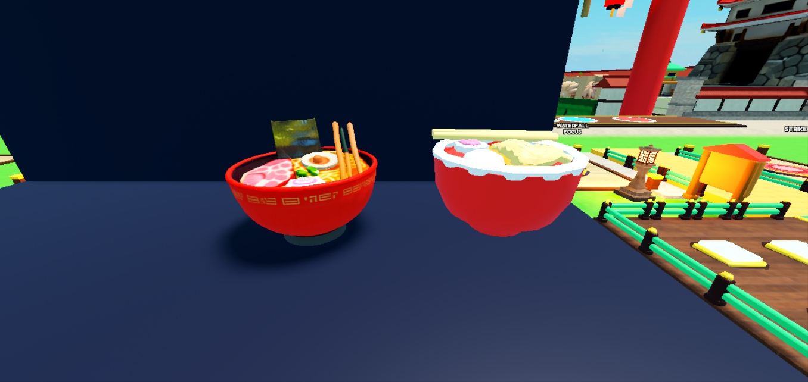
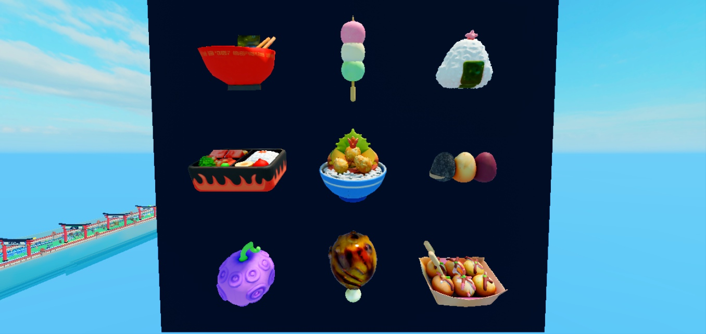

# Plan 13: food and training v2

**Status: APPROVED by the owner on 2026-11-26 (all seven decisions as recommended). Build log: section 11.**

The owner's ask: more and better foods that belong to the anime worlds, with calculated numbers so
nobody gets bored; food models, textures, animation and effects at a professional level; and the
training ("exercise") replaced by something interactive, fun, simple, playable AND leave-running,
that can evolve into another game after enough upgrades.

Numbers in this plan come from `tools/economy/econ_v3.py` (a draft tool: it writes
`design/plan/13-economy-draft.json`, never `design/game.json`). Rerun: `gen`, `sim`, `cadence`, `table`.

## 1. In one page

| | Today | Plan 13 |
|---|---|---|
| Foods | 12, generic, flat-coloured, no textures | **51: three per world (Snack, Meal, Signature), each a dish from that world's anime**, textured |
| What food does | luck x1 to x5.5 and reach x1 to x5 | **luck only**, strong steps (x1 → x1.45 → x2 inside every world); reach comes from Power alone |
| Where a food works | everywhere the same | full luck in its own world and every earlier one; **half luck in a later world** (heroes want the food of their own world) |
| Cravings | four flavours | **each hero has a favourite dish** of its own world (x3 chance inside its rarity, as today) |
| Training stations | 2 (punch a dummy, sit under a waterfall), one tap ring | **8 training grounds, one new one per rebirth**, each with its own one-thumb game |
| Training upgrades | 19 | **57 (three levels per tier)** |
| Leave it running | yes, loses about a third | yes, **x1.0**; playing is worth about **x1.85** (typical) to **x2.3** (perfect) |
| Things to buy per world | 2 or 3 (late worlds: one per 70 to 100 minutes) | **7 or 8 (late worlds: one per 25 to 30 minutes)** |
| Time to the last world, free | about 30 h | about 28 h; all seven approved pacing checks pass |

## 2. What is there today (measured in the place, 2026-11-26)

- `ReplicatedStorage.Assets.Foods`: 12 models, 3 to 5 flat-coloured mesh parts each, **0 textures**.
- `ReplicatedStorage.Assets.Gear`: 8 models for 19 gear tiers (11 tiers reuse a model), **0 textures**.
- Training: reps on a 1 s clock, one tap ring, +50% for a perfect tap. Two stations.
- Purchases: 19 gear + 12 foods + 16 slots + 10 rebirths = 57 in about 30 hours. Worlds 7, 9, 11,
  13, 15 and 17 have no new food at all.

Sample made for this plan with Studio's mesh generator (left) next to the current ramen (right):

The same test also returned a failed model (a "meat on the bone" came back as a lump with six
bones). That is the honest state of the generator: every food has to be looked at, and remade
until it is right. The plan budgets for that (section 4).

## 3. Research

**The reference game, Throw Food For Animals (state on 2026-11-26)**
- 54 foods over 20 zones, all bought with cash, permanent, sold in a fixed order. 64 training bars.
  Every weekly update adds one zone, four foods and 6 to 8 bars.
  [game.guide/throw-food-for-animals/foods, eldorado.gg, bloxodes.com]
- Food is a "bait level" and nothing else: no distance, no power. Each zone has its own three
  foods; the first aims at about rank 2 of that zone's animals, the second at rank 5, the third at
  rank 8. Food from an earlier zone aims at rank 1. [game.guide, one source for the exact ranks]
- Training: pull-up bars, reps run by themselves every 0.5 s; a pop-up every 4 to 6 s is the only
  input and is worth about +10% (my arithmetic from the published numbers). Each bar doubles the
  one before. [game.guide/throw-food-for-animals/training-bars, allthings.how]
- No food variants, no food collection, no food behind Robux.

**Training games that do well on Roblox** (sources in the research agent's report; thin where
wikis blocked reading, and no public retention numbers exist)
- The genre standard is free auto-reps with an optional tap bonus. Where the bonus is tiny
  (+10%, the reference) players ignore it; where tapping is forced (stamina, click per rep)
  guides tell players to use auto-clickers.
- What works: an idle floor with an active ceiling 2 to 3 times higher, played in short bursts.
- Games that change the activity at milestones (Arm Wrestle Simulator's grips, barbells, bags,
  walls; Anime Fighting Simulator's Chakra Tree, Waterfall, Gravity Chamber; Gym League's boulder
  game at the fourth gym) keep a "what is the next one" goal. Re-skins alone (the reference's 64
  bars) are cheap but are the same activity for the whole game.
- Pay per judged event on the server, never per tap; ignore inputs closer than 0.1 s.

**What I take from it:** food as each world's own bait is the proven core of the genre and fits
"foods related to anime" exactly. Training is the reference's weakest part, so it is where this
game can be clearly better.

## 4. Food

### 4.1 Rules

1. **51 foods = 17 worlds x 3.** Every world sells a **Snack**, a **Meal** and a **Signature
   dish**, all dishes people know from that anime. Names are dishes, never franchise names (the
   same rule as the hero aliases).
2. **Food gives Luck, nothing else.** How far you throw is your Power (training). One job each.
3. **Luck inside a world:** Snack x1.0, Meal x1.45, Signature x2.0, times the world's base, which
   grows 8% per world (world 1 = 1.0, world 17 = 3.43). So the ladder runs from x1.0 (Onigiri) to
   x6.85 (Warrior's Feast), and every purchase inside a world is a step of about +40%.
4. **Home-world rule:** a food has its full Luck in its own world and in every earlier world. In a
   later world it counts **half**. On arriving in a new world the old Signature is worth less than
   the new Snack, so the new world's cheap Snack is the first thing to buy there.
   Going back to finish an old world's Index with a late food works at full strength.
5. **Auto-pick** (on by default): the game equips your best food for the world you aim at. A
   player who never opens the food bag is never punished by rule 4. Picking by hand stays possible.
6. **Favourite dish** (replaces the four flavours): every hero has one favourite among its own
   world's three dishes, shown on its Index tile and on the catch card. Throwing a hero's
   favourite makes it three times as likely inside its rarity (today's craving rule, unchanged).
   Favourites are spread over the three dishes in every world and rarity, iconic pairs first.
7. **Unlock and price:** a world's three foods unlock when you first reach that world; they cost
   2%, 7% and 18% of what that world pays a free player in its target time. Any unlocked food can
   be bought in any order.
8. **Cookbook:** a Foods tab in the Index. Owning all three dishes of a world gives one Lucky
   Throw (17 in total). No grind, no throw counters.
9. **Fair-play line unchanged:** no food is sold for Robux.

**Why 51.** The reference has 54 for 20 zones (2.7 per zone). Three per world gives every world
the same clear shape, an anime-true set of dishes, and with the training levels one thing to buy
every 1 to 4 minutes in the first worlds and every 25 to 30 minutes in the last ones. Two per
world (34) leaves gaps over an hour late in the game; four (68) adds 17 models without closing
any gap that matters.

### 4.2 The 51 foods (luck and price from the draft; names are open to the owner's changes)

| World | Snack | Meal | Signature dish |
|---|---|---|---|
| 1 Hidden Leaf Village | Onigiri, x1, free | Tricolor Dango, x1.45, 520 | Legendary Ramen, x2, 1.3K |
| 2 Demon Slayer Corps | Ohagi, x1.08, 12K | Tempura Bowl, x1.57, 43K | Flame Bento, x2.16, 110K |
| 3 Grand Line | Sea King Takoyaki, x1.17, 230K | Meat on the Bone, x1.69, 820K | Swirl Fruit, x2.33, 2.1M |
| 4 Hero Academy | Cold Soba, x1.26, 5.9M | Hero's Katsudon, x1.83, 21M | Explosion Mapo Tofu, x2.52, 53M |
| 5 Blue Lock Facility | Kintsuba, x1.36, 160M | Striker Gyoza, x1.97, 550M | Rank One Steak, x2.72, 1.4B |
| 6 Clover Kingdom | Village Tatoes, x1.47, 2.4B | Four-Leaf Cake, x2.13, 8.4B | Cotton Sheep Feast, x2.94, 22B |
| 7 Hunter Exam | Robo Choco Balls, x1.59, 43B | Exam Sushi, x2.3, 150B | Giant Boar Roast, x3.17, 390B |
| 8 Isekai Crossroads | Isekai Apple, x1.71, 490B | Flying Cabbage Stir-fry, x2.49, 1.7T | Floor Boss Stew, x3.43, 4.4T |
| 9 Wall Maria | Steamed Potato, x1.85, 5.1T | Scout Ration Bread, x2.68, 18T | Officer's Ham, x3.7, 46T |
| 10 Public Safety HQ | Jam Toast, x2, 82T | Devil Hunter Burger, x2.9, 290T | Devil Ice Cream, x4, 740T |
| 11 Bizarre Streets | Double Cherry, x2.16, 820T | Margherita Pizza, x3.13, 2.9Qa | Healing Squid Ink Pasta, x4.32, 7.4Qa |
| 12 Shadow Council | Consomme Chips, x2.33, 10Qa | Reaper's Apple, x3.38, 36Qa | Detective's Cake Tower, x4.66, 92Qa |
| 13 City Z | Hero's Banana, x2.52, 200Qa | Hero Udon, x3.65, 710Qa | Crab Hot Pot, x5.04, 1.8Qi |
| 14 Soul Society | Soul Candy, x2.72, 1.3Qi | Strawberry Daifuku, x3.94, 4.5Qi | Captain's Curry, x5.44, 12Qi |
| 15 Gate of Shadows | Hunter Kimbap, x2.94, 17Qi | Fire Rice Cakes, x4.26, 60Qi | Elixir of Life, x5.87, 150Qi |
| 16 Shibuya | Shibuya Crepe, x3.17, 160Qi | Meatball Hot Pot, x4.6, 550Qi | Infinity Cream Mochi, x6.34, 1.4Sx |
| 17 Planet of the Gods | Hermit Bean, x3.43, 9.1Sx | Destroyer's Pudding, x4.97, 32Sx | Warrior's Feast, x6.85, 82Sx |

Odds a free player sees per throw (food x average depth and perfect x rebirth luck):

| World | Food | Luck | Rare | Epic | Legendary | Mythic | Secret |
|---|---|---|---|---|---|---|---|
| 1 | Snack | x1.18 | 1 in 8 | 1 in 42 | 1 in 339 | 1 in 8,475 | not here |
| 1 | Signature | x2.36 | 1 in 5 | 1 in 21 | 1 in 169 | 1 in 4,237 | not here |
| 3 | Snack | x1.38 | 1 in 7 | 1 in 36 | 1 in 291 | 1 in 7,266 | not here |
| 3 | Signature | x2.75 | 1 in 5 | 1 in 18 | 1 in 145 | 1 in 3,633 | not here |
| 5 | Snack | x1.77 | 1 in 6 | 1 in 28 | 1 in 227 | not here | not here |
| 5 | Signature | x3.53 | 1 in 4 | 1 in 14 | 1 in 113 | not here | not here |
| 9 | Snack | x2.84 | 1 in 5 | 1 in 18 | 1 in 141 | not here | not here |
| 9 | Signature | x5.68 | 1 in 3 | 1 in 9 | 1 in 70 | not here | not here |
| 13 | Snack | x4.46 | 1 in 4 | 1 in 11 | 1 in 90 | 1 in 2,244 | 1 in 224,358 |
| 13 | Signature | x8.91 | 1 in 2 | 1 in 6 | 1 in 45 | 1 in 1,122 | 1 in 112,179 |
| 17 | Snack | x6.87 | 1 in 3 | 1 in 7 | 1 in 58 | 1 in 1,455 | 1 in 145,509 |
| 17 | Signature | x13.74 | 1 in 2 | 1 in 4 | 1 in 29 | 1 in 728 | 1 in 72,754 |

### 4.3 Look and feel (the quality bar)

Per food, all of these, or it is not done:

1. **Model:** one textured mesh from Studio's mesh generator, at most 3,000 triangles, made
   large and scaled down. Judged at maximum graphics in the hand, in flight and in the shop.
   Wrong shape, smeared texture or an unfinished back = remade (expect two or three tries each;
   a dish that never comes right is modelled by hand in Blender). Squared, pivot at the grip.
2. **Shop and HUD:** the real 3D model, slowly turning on its card, on a plate of its world's
   colour; Signature dishes get a gold frame and a shine sweep.
3. **Hold and throw, three classes:** one-hand pitch (small things), two-hand heave (bowls,
   plates, feasts), spin toss (skewers, pizza, flat things). Three hold poses and three throw
   clips, judged on rendered frames.
4. **Flight:** each class spins its own way (a bowl stays upright and trails steam, a skewer
   turns end over end). Snack: a clean streak. Meal: streak and sparks. Signature: its own
   effect (below).
5. **Landing:** Snack a dust puff; Meal a ring and aroma wisps; Signature a pillar of its own
   colour and aroma lines that the hero follows in. A favourite dish adds a "FAVOURITE!" burst
   and the hero's happy reaction.
6. **Sound:** a throw whoosh per class, a landing per dish type (bowl clink, sizzle, soft
   thump), a short sting for a Signature.

**The 17 Signature effects** (each built from the dish, textures made for it, judged frame by
frame in the simulator and then in the game at maximum graphics):

| World | Signature dish | Effect in flight and on landing |
|---|---|---|
| 1 | Legendary Ramen | steam spiral with a pink fish-cake swirl ring |
| 2 | Flame Bento | a tail of flame, embers on landing |
| 3 | Swirl Fruit | purple spiral ribbons, a dark pulse on landing |
| 4 | Explosion Mapo Tofu | orange pops along the path, a small blast |
| 5 | Rank One Steak | blue speed lines, a gold "1" flash |
| 6 | Cotton Sheep Feast | soft wool puffs and clover leaves |
| 7 | Giant Boar Roast | heavy smoke trail, ground shake |
| 8 | Floor Boss Stew | blue polygon shards (game-world break) |
| 9 | Officer's Ham | steam and green cape-wing feathers |
| 10 | Devil Ice Cream | cold mist, a red chain-link spark ring |
| 11 | Healing Squid Ink Pasta | golden sparkle with drifting menacing-style glyphs |
| 12 | Detective's Cake Tower | sugar cubes and black feathers |
| 13 | Crab Hot Pot | steam burst with a single clean shockwave |
| 14 | Captain's Curry | black and white spirit pressure streaks |
| 15 | Elixir of Life | violet rune circle, blue glow |
| 16 | Infinity Cream Mochi | blue and red orbs joining to violet |
| 17 | Warrior's Feast | golden aura flare, lightning crackle |

## 5. Training

### 5.1 One framework, eight grounds

Every training ground works the same way underneath, so the balance is one set of numbers:

- **Stand on it and it trains.** Reps run on the server's clock, one per second, at **x1.0**.
  This never stops and needs no input: the leave-it-running mode.
- **Play it and it pays more.** Each ground shows one **beat** at a time (a ring to hit, a hold
  to let go of, a side to tap). The server judges each beat: **Perfect** doubles that beat's
  reps, **Good** adds half, a miss still pays the plain reps. One thumb, big targets on the
  right side of the screen.
- **Focus and AWAKENING.** Perfect gives 2 Focus, Good gives 1. At 40 the hero awakens for 8
  seconds: aura on, every rep is an automatic Perfect and pays x1.5 on top, no input needed (the
  thumb rests and the player watches the payoff). Then Focus starts again.
- **What that is worth** (calculated):

| Player | Hits | Rate while playing | Awakening every |
|---|---|---|---|
| Leaves it running | none | x1.00 | never |
| Casual | 20% perfect, 50% good | x1.69 | 52 s |
| Typical | 40% perfect, 40% good | x1.87 | 41 s |
| Good | 60% perfect, 30% good | x2.04 | 35 s |
| Perfect | every beat | x2.29 | 28 s |

- **Cheating:** beats are placed and timed by the server with jitter, so a fixed-interval
  auto-clicker lands on Good at best; one judgement per beat, extra taps ignored.
- Double Training (pass), training packs, the rebirth bonus (+25% a tier) and muscle memory (x4
  below your record) all multiply this, as today.

### 5.2 The eight grounds

One new ground per rebirth band. A base always shows the **two newest** (one on each court), and
both pay the same, so there is always a choice of two games. In the first band the second court
shows the Waterfall locked, with "REBIRTH 1" on it: a visible reason to take the first rebirth.

| # | Ground | Opens | The game (one rule) | Beat | Awakening moment |
|---|---|---|---|---|---|
| 1 | Striking Post | start | a ring closes on a weak spot on the post: tap as it lands | 1 s | a flurry, the post bursts into splinters and a thicker one rises |
| 2 | Waterfall Focus | rebirth 1 | hold as the breath ring fills, let go in the gold band | 3 s | the waterfall splits and runs upward |
| 3 | Boulder Breaker | rebirth 2 | a needle sweeps a meter: tap in the sweet spot, each hit cracks the rock | 2 s | the boulder shatters, a bigger one drops in |
| 4 | Thunder Peak | rebirth 3 | lightning marks one of three rods: tap that side before it strikes | about 2 s | the hero is wrapped in lightning |
| 5 | Gravity Chamber | rebirth 4 | push-ups to a beat under a gravity dial (10G to 500G): tap on the beat | 1 s, with rests | gravity flips, the hero floats |
| 6 | Spirit Orb | rebirth 5 | hold to grow an energy orb overhead, let go on the gold pulse | 4 s | the orb is thrown to the sky and bursts |
| 7 | Titan Chains | rebirth 6 | three rings in a row (tap, tap, tap), then a rest, hauling a chained colossus weight | 3 s | the chains snap, the weight is lifted overhead |
| 8 | Timeless Hall | rebirth 7 | a medley: every 20 s it switches between the earlier games, faster | mixed | the white hall fills with every earlier aura |

Each ground is a full set piece on the court: textured models, its own two animations (training
loop and awakening), effects, sounds and music sting, a sign with its name and level.

### 5.3 Upgrades: 57 levels

- The 19 gear tiers stay (17 by world reached, 2 for rebirths 8 and 9). Each tier now has **three
  levels (I, II, III)** bought with Yen: x0.6, x1.0 and x1.5 of the tier's base Power per rep.
- **Every tier changes the look** of its ground (the post gets iron bands, the waterfall gets
  taller, the gravity dial reads higher); every level adds a visible piece (ropes, charms, glow).
- **The evolution the owner asked for:** a ground has 6 upgrades (9 for the first, 12 for the
  last); the next upgrade after those needs the next rebirth, and it is a new ground with a new game.
- Prices: 1.5%, 4.5% and 10% of what the tier's world pays in its target time.

| Tier | Unlocks at | Ground | Power per rep I / II / III | Price I / II / III |
|---|---|---|---|---|
| 1 | world 1 | Striking Post | 1 / 2 / 3 | free / 330 / 740 |
| 2 | world 2 | Striking Post | 3 / 6 / 8 | 9.3K / 28K / 62K |
| 3 | world 3 | Striking Post | 20 / 33 / 49 | 180K / 530K / 1.2M |
| 4 | world 4 | Waterfall Focus | 110 / 180 / 280 | 4.4M / 13M / 29M |
| 5 | world 5 | Waterfall Focus | 760 / 1.3K / 1.9K | 120M / 350M / 790M |
| 6 | world 6 | Boulder Breaker | 6.6K / 11K / 17K | 1.8B / 5.4B / 12B |
| 7 | world 7 | Boulder Breaker | 63K / 110K / 160K | 32B / 97B / 220B |
| 8 | world 8 | Thunder Peak | 530K / 880K / 1.3M | 370B / 1.1T / 2.4T |
| 9 | world 9 | Thunder Peak | 5.1M / 8.6M / 13M | 3.8T / 11T / 26T |
| 10 | world 10 | Gravity Chamber | 50M / 83M / 120M | 62T / 180T / 410T |
| 11 | world 11 | Gravity Chamber | 530M / 880M / 1.3B | 620T / 1.8Qa / 4.1Qa |
| 12 | world 12 | Spirit Orb | 5.3B / 8.8B / 13B | 7.7Qa / 23Qa / 51Qa |
| 13 | world 13 | Spirit Orb | 58B / 96B / 140B | 150Qa / 460Qa / 1Qi |
| 14 | world 14 | Titan Chains | 580B / 970B / 1.5T | 970Qa / 2.9Qi / 6.5Qi |
| 15 | world 15 | Titan Chains | 6.2T / 10T / 15T | 13Qi / 38Qi / 85Qi |
| 16 | world 16 | Timeless Hall | 59T / 98T / 150T | 120Qi / 350Qi / 780Qi |
| 17 | world 17 | Timeless Hall | 650T / 1.1Qa / 1.6Qa | 6.8Sx / 20Sx / 46Sx |
| 18 | rebirth 8 | Timeless Hall | 1.6Qa / 2.7Qa / 4Qa | 91Sx / 160Sx / 230Sx |
| 19 | rebirth 9 | Timeless Hall | 14Qa / 23Qa / 34Qa | 180Sx / 320Sx / 460Sx |

## 6. The numbers, checked

`python tools/economy/econ_v3.py sim` (median of 7 simulated players per column, 48 h each):

| Milestone | Average | Leaves it running | Plays (typical) | Plays perfectly | x2 Training pass | All passes | Window (plan 12) |
|---|---|---|---|---|---|---|---|
| World 2 | 2m55s | 3m58s | 2m41s | 2m13s | 2m06s | 1m59s | 1.5 to 5 min |
| World 3 | 12m08s | 15m45s | 10m51s | 9m41s | 8m24s | 7m21s | 9 to 19 min |
| Rebirth 1 | 30m06s | 39m33s | 28m00s | 26m22s | 23m55s | 16m27s | 25 to 46 min |
| Rebirth 2 | 1h52m | 2h20m | 1h41m | 1h31m | 1h24m | 56m35s | 1h33 to 2h48 |
| Rebirth 4 | 7h19m | 9h29m | 6h45m | 5h58m | 5h32m | 3h55m | 6h10 to 11h |
| Rebirth 7 | 24h27m | 31h07m | 22h27m | 20h21m | 18h30m | 12h37m | 19h30 to 35h10 |
| World 17 (the last) | 28h12m | 36h01m | 25h51m | 22h53m | 21h14m | 14h37m | 23h to 41h20 |

- "Average" is the design player: plays about 60% of training time, leaves it running for the rest.
- All seven pacing windows approved in plan 12 pass for the average free player.
- Leaving training running for the whole game costs about 8 hours on the way to the last world;
  playing every beat perfectly saves about 5. Passes keep the bounds plan 12 approved.

Minutes between purchases, by world (average free player):

| World | Minutes there | Purchases | Average gap | Longest gap |
|---|---|---|---|---|
| 1 | 3 | 4 | 0.8 min | 1.1 min |
| 2 | 9 | 6 | 1.5 min | 2.0 min |
| 3 | 20 | 8 | 2.5 min | 4.1 min |
| 4 | 30 | 8 | 3.8 min | 6.9 min |
| 5 | 53 | 7 | 7.5 min | 10.8 min |
| 6 | 59 | 7 | 8.4 min | 13.2 min |
| 7 | 82 | 7 | 11.7 min | 18.6 min |
| 8 | 82 | 7 | 11.7 min | 19.7 min |
| 9 | 123 | 8 | 15.3 min | 22.6 min |
| 10 | 117 | 7 | 16.7 min | 28.2 min |
| 11 | 145 | 8 | 18.1 min | 32.1 min |
| 12 | 137 | 7 | 19.6 min | 32.7 min |
| 13 | 204 | 7 | 29.1 min | 55.1 min |
| 14 | 170 | 7 | 24.2 min | 37.9 min |
| 15 | 242 | 8 | 30.2 min | 47.7 min |
| 16 | 204 | 7 | 29.1 min | 44.9 min |
| 17 | 240 (target) | 7 | about 34 min | not simulated to its end |

In the last worlds a hero is still caught every 7 seconds, and each rebirth brings two worlds,
six foods and a new training ground, so the long gaps are between purchases, not between events.

Slot prices and rebirth fees move a little with the new income (all in the draft JSON); the
rebirth Power gates do not change.

## 7. What changes in the project

- **Numbers:** `econ_v3.py` gets an `apply` (as v2 has) and becomes the pacing gate; `design/game.json`
  gets `Foods` (51, with `Zone`, `Role`, `Luck`), `Training.Equipment` (57), `Training.Grounds` (8),
  the beat and Focus constants; `PowerMult` and `Flavors` go. `gen_characters.py` gives each hero a
  `Favourite` from `design/characters/lineup.json`.
- **Rules (pure modules with specs):** `Luck` (food luck by aimed world), `Throw` and `Progress`
  (reach = Power), `Roll` (favourite instead of flavour), new `Core/Beat` (the judge: windows,
  Focus, awakening, jitter) and `Core/Foods` (best food for a world, cookbook sets).
- **Server:** ThrowService, ShopService, ProgressService, RewardsService, AdminService (reach and
  food luck), TrainingService (grounds, beats, Focus, levels). Saves move to `Profiles_v3`
  (nothing is published, so no player data is lost).
- **Client:** FoodShop (grouped by world, 3D models, "BEST HERE" and "half luck here" tags),
  HUD food chip, aim panel and Throw Odds page (food luck for the aimed world), Index (favourite
  dish, Cookbook tab), TrainingController rebuilt on the beat framework with one small view per
  game, Rebirth page ("opens: 2 worlds, 6 foods, <ground>").
- **Place:** food templates replace `Assets.Foods`; ground templates replace `Assets.Gear`; the
  12 old foods and 8 old gear models go to `ServerStorage.MapArchive` (never deleted).

## 8. Build order (each phase ends with the owner's look)

| Phase | What | Done when |
|---|---|---|
| A | Rules, numbers, code and screens wired (old models stay in for this phase only) | all gates green, the pacing gate on `game.json`, a headless run through ten rebirths |
| B | The 51 foods, in six batches by rebirth band (9, 6, 6, 6, 6, 6+12) | each batch shown to the owner as a picture sheet from the game at maximum graphics |
| C | Throw feel: three hold/throw clips, flight, trails, 17 Signature effects, landings, sounds | judged in the game on a phone and a PC |
| D | Training framework + grounds 1 and 2 complete | the owner plays both and approves the bar |
| E | Grounds 3 to 8, two at a time | each pair played by the owner |
| F | Full playtest through all rebirths, phones, tuning, snapshot (commit, tag, save) | the owner's sign-off |

## 9. Risks and what is not proven yet

- **The mesh generator misses** (one of the two samples failed). Every food is judged; the plan
  counts on remakes. Its moderation also refuses some words; prompts are worded plainly.
- **Hit rates are assumptions** (40% perfect, 40% good for a typical player). Phase D measures
  real rates in play; the Focus and bonus constants are in config and the simulator covers the
  whole range from leave-running (36 h) to perfect (23 h), so a wrong guess moves a player
  inside a range that is already acceptable.
- **Phones:** 51 textured models are never loaded at once (only equipped foods and the open
  shop page); each ground is one set piece per base. Frame rate is measured in phase F.
- **Names:** dishes only, no show, character or place names. Where a show uses an invented word
  for a food, the plan uses a plain one instead (Swirl Fruit, Hermit Bean, Isekai Apple, Village
  Tatoes). The owner can change any name.

## 10. Decisions for the owner

1. **51 foods, three per world** (recommended). Other choices: 34 (two per world) or 68.
2. **Food gives luck only; throwing distance comes from training only** (recommended).
   Other choice: keep a small reach bonus on food as today.
3. **Home-world rule with auto-pick**: half luck in a later world (recommended).
   Other choice: one ladder that works the same everywhere, with steps of about +4% per food.
4. **Favourite dish replaces the four flavours** (recommended).
5. **Eight training grounds, one per rebirth, each with its own game** (recommended).
   Other choices: four grounds (one per two rebirths), or keep and polish the current two.
6. **57 training levels, three per tier** (recommended).
7. **Playing is worth about x1.85 over leaving it running** (x2.3 at most) (recommended).

## 11. Build log

**Phase A (rules, numbers, code, screens wired), 2026-11-26: built, awaiting the owner's look.**
- Numbers: `econ_v3.py` got `apply` and `check`; `tools/gate.py` runs it as the pacing gate.
  `design/game.json` has the 51 foods (`Zone`, `Role`, `Luck`), 57 training rows (`Tier`, `Level`,
  `Ground`, `Model` = the old tier model until phase D), `Training.Grounds`, `Training.Beat`,
  `Luck.StaleFood`, `Rewards.CookbookLuckyThrows`; `Flavors` and `PowerMult` are gone. Saves:
  `Profiles_v3` / `Profiles_Dev_v3`. Zone 1's levels are hand-set to 1, 2, 3 Power per rep and
  every upgrade is forced stronger than the one before.
- Heroes: `Favourite` (a food id) replaces `Craves`; iconic pairs in
  `design/characters/favourites.json`, the rest dealt by `gen_characters.py`.
- Rules: `Core/Foods` (luck by world, best food, cookbook), `Core/Beat` (the judge), `Throw` and
  `Progress` without food reach, `Roll` by favourite. Spec `tests/Foods.spec.luau`; 136 specs pass.
- Server: the throw picks the food AFTER the landing zone is known (auto-pick or the pinned one)
  and tells the client which (`result.food`); the shop pins on equip, `"auto"` unpins, and pays the
  cookbook; training grades one tap per jittered beat, fills Focus and awakens.
- Client: `Ui/FoodLook` (which food is thrown, how it is drawn; foods without a model of their own
  borrow one of the twelve old ones until phase B), HUD chip (AUTO / PINNED), throw panel, shop
  (worlds reached + the next, role, luck where the next throw goes, IN USE / PIN / PINNED),
  Index and catch card (favourite dish), rebirth page, training ring on beats with Focus in the
  hint line.
- Played in Studio: auto-pick threw the Legendary Ramen and doubled the luck (1.92 -> 3.88),
  the favourite match registered, pin and unpin work, the cookbook paid one Lucky Throw, a gear
  level was bought; 20 perfect taps filled Focus to 40, the awakening ran 8 s and taps during it
  were ignored. The food shop was looked at in the game.
- NOT done in phase A: the second court stays locked until rebirth 1 but still shows the old
  waterfall; the Index, catch card, rebirth page and training hint were not looked at on screen;
  the shop keeps its old one-row layout (an empty strip where the flavour filters were); no
  Cookbook tab yet; no ten-rebirth run in Studio (the headless Journey spec walks the whole lane).

**Phase B, batch 1 (worlds 1 to 3, nine foods), 2026-11-26: built, awaiting the owner's look.**

- Pipeline (rerunnable, in `tools/studio/foods/` and `tools/ui/food_icons_v2.py`; sizes, turns and throw
  classes in `design/foods.json`): generate_mesh with the prompt starting `FOOD_<id>:` -> `food_lab.luau`
  (judging row; a newer try replaces the older, old tries go to `ServerStorage.FoodLabRejected`) ->
  `install_foods.py` (templates `Assets.Foods.Food_<id>`, raw copies in `StoreAssets.Foods_v2`, the twelve
  old models in `MapArchive.Foods_v1`) -> `food_icons_v2.py` (icons rendered from the templates on a white
  and a black wall, cut out by their difference, ink outline, uploaded; `ids_food_icons_v2.json`).
- Tries: onigiri, dango, ramen, tempura bowl, takoyaki, swirl fruit 1 each; ohagi and bento 2; the meat 4
  (an American football, then pink and spotted three times) and then its texture redone with
  generate_texture. The meat is the weakest of the nine.
- Traps: a model with a PrimaryPart ignores `WorldPivot` (turn it through the part's `PivotOffset`); the
  generator lays some models down (`turn` in foods.json); a retextured mesh carries a SurfaceAppearance
  that loads late (its first icon came out grey); a capture now and then shows the wall before its new
  colour (the tool retries).
- Seen in the game: the shop cards (3D models, textured), the throw panel icon. A bowl, plate or tray now
  stays level in the hand during the wind-up (it was tipped on its side); that fix is not looked at yet.

**Phase B, batch 2 (worlds 4 and 5, six foods), 2026-11-26: built, awaiting the owner's look.**
- Cold Soba, Hero's Katsudon, Explosion Mapo Tofu, Kintsuba, Striker Gyoza: one try each. Rank One Steak:
  two (the first was a glossy red disc on a pink plate). 15 of 51 foods now have their own model and icon
  (sheet: `assets/ui/food_icons_v2_sheet.png`).
- The Kintsuba came on a stick and the gyoza without their plate; both read well and were kept.
- Not looked at in the game yet (the templates and icons are installed the same way as batch 1).

**Phase B, batch 3 (worlds 6 and 7, six foods) + flight styles, 2026-11-26: built, awaiting the owner's look.**
- Village Tatoes, Four-Leaf Cake, Cotton Sheep Feast, Robo Choco Balls, Exam Sushi, Giant Boar Roast: one try
  each. 21 of 51 foods have their own model and icon. The candy box has gears instead of a robot face and
  the sushi no board; both kept.
- Flight (owner's question: will a bowl look odd spinning): `ThrowController.flightTurn` reads the
  template's `Throw` attribute. heave = level, top leaning 22 degrees toward the chase camera, slow flat
  turn; spin = end over end; anything else = a tumble at about half the old speed. Measured in play on the
  Legendary Ramen: level in the hand, a constant lean through the flight, upright after landing.
- Open: in the landing close-up a bowl fills most of the frame (foods are drawn 1.7x in flight and the
  camera was set for the old, smaller models): phase C.

**Checkpoint, 2026-11-26:** phase A and food batches 1 to 3 committed (dfa0551) and saved as place version
921 ("Plan 13: rules + foods of worlds 1-7"). Not pushed, not published. Not a section snapshot: no tag.

**Phase B, batch 4 (worlds 8 and 9, six foods), 2026-11-26: built, awaiting the owner's look.**
- Isekai Apple, Flying Cabbage Stir-fry, Floor Boss Stew, Scout Ration Bread: one try each. Steamed Potato:
  two (the first was a pale lump). Officer's Ham: came pink like raw sausage, texture redone with
  generate_texture. 27 of 51 foods have their own model and icon.
- Trap: generate_texture hands the model back without its PrimaryPart and turned; set the PrimaryPart again
  before install_foods.py. A capture comes back as a blank dark frame when the display has blanked during a
  wait: run tools/studio/front.ps1 right before it.

**Phase B, batch 5 (worlds 10 and 11, six foods), 2026-11-26: built, awaiting the owner's look.**
- Jam Toast, Devil Hunter Burger, Devil Ice Cream, Double Cherry, Margherita Pizza, Healing Squid Ink Pasta:
  one try each. 33 of 51 foods have their own model and icon.
- Trap: one icon (the black pasta) came out as a small dark blob on its first render although the tool said
  ok: LOOK at the sheet after every icon run, the tool cannot tell a bad capture from a good one.

**Phase B, batch 6 (worlds 12 to 17, eighteen foods), 2026-11-27: built. PHASE B IS COMPLETE: all 51 foods
have their own textured model and icon (sheet: `assets/ui/food_icons_v2_sheet.png`).**
- Seventeen passed on the first try. The Warrior's Feast took two: its roast came with a cartoon face; the
  remake arrived standing on its edge (`turn` [90, 0, 0]).
- Trap: after a Studio restart the editor's grid lines show in the 3D view and in every capture; the icon
  cut-out took them for part of the food and nine icons came out tiny. `food_icons_v2.py` now erodes the mask
  before it measures the food (hairlines vanish) and refuses a food that is far too small in the picture.
- A spec now fails if any food in the config has no icon of its own.
- Whole phase, tries per food: 41 of 51 on the first try, 8 on the second, the meat on its fourth plus a
  texture pass, the ham on a texture pass. Not looked at in a play session: batches 2 to 6 (only batch 1's
  shop cards and the ramen's throw were seen in the game).
